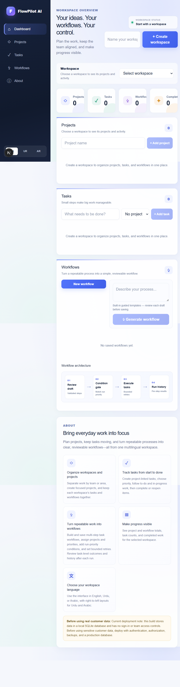

# FlowPilot AI

A multilingual business operations and workflow SaaS starter.



## Run locally

Copy `frontend/.env.local.example` to `frontend/.env.local` and configure a
Supabase project plus the local API URL before signing in. The backend uses a
separate local-only SQLite database by default.

### Backend

```bash
cd backend
py -m pip install -r requirements.txt
py -m uvicorn app.main:app --reload --port 8000
```

### Frontend

```bash
cd frontend
npm.cmd install
npm.cmd run dev
```

Open http://localhost:3000.

## What it can do

- Create workspaces and organize work into projects.
- Create, prioritize, assign, and complete tasks.
- Build and save reusable multi-step task workflows, manually or from guided templates.
- Assign workflow-created tasks to projects and priorities.
- Add run-priority conditions and configure up to three bounded retries per task step.
- Run workflows repeatedly and review persisted per-step results and run history.
- View workspace metrics in English, Urdu, and Arabic, with RTL layouts for Urdu and Arabic.

Workflow actions currently create tasks inside FlowPilot. They do not send email, call external services, or execute arbitrary code.

## Security and production readiness

The API verifies Supabase access tokens and scopes workspaces to the signed-in
owner. Local development uses SQLite; production requires PostgreSQL. A
production deployment still requires provider configuration and verification
of account isolation, backups, and recovery before using sensitive customer
data. See [docs/VERCEL_DEPLOYMENT.md](docs/VERCEL_DEPLOYMENT.md) for deployment
steps and [docs/SECURITY.md](docs/SECURITY.md) for remaining milestones.

## Validation

```bash
cd backend
py -m pytest -q

cd ../frontend
npm.cmd run lint
npm.cmd run build
```
